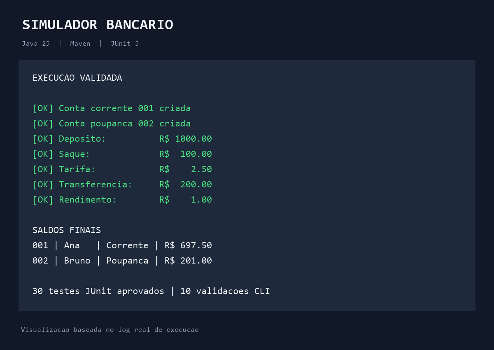

# Simulador de Conta Bancaria em Java

Simulador bancario de linha de comando desenvolvido com Java 25, Maven e JUnit 5.

## Funcionalidades

- Criacao de contas correntes e poupancas
- Depositos e saques
- Transferencias entre contas
- Consulta de saldos e extratos
- Tarifa de R$ 2,50 por saque em conta corrente
- Rendimento de 0,5% por aplicacao na poupanca
- Validacao de valores monetarios com BigDecimal

## Tecnologias

- Java 25
- Maven
- JUnit Jupiter 5.11.4
- GitHub Actions

## Executar

Requisitos: JDK 25 e Maven.

```powershell
mvn clean verify
java -cp target/classes br.com.portfolio.banco.App
```

Os valores monetarios devem ser informados com ponto decimal, por exemplo `100.50`.

## Demonstracao

A imagem abaixo apresenta uma representacao visual de uma execucao real validada da CLI.



### Cenario validado

| Operacao | Resultado |
| --- | --- |
| Deposito na conta corrente | R$ 1.000,00 |
| Saque na conta corrente | R$ 100,00 |
| Tarifa de saque | R$ 2,50 |
| Transferencia para poupanca | R$ 200,00 |
| Rendimento da poupanca | R$ 1,00 |
| Saldo final da conta corrente | R$ 697,50 |
| Saldo final da poupanca | R$ 201,00 |

## Testes

A suite possui 30 testes unitarios com JUnit 5. A integracao continua executa `mvn -B clean verify` a cada push e pull request.

## Arquitetura

- `Conta`: classe abstrata com operacoes bancarias compartilhadas
- `ContaCorrente`: especializacao com tarifa de saque
- `ContaPoupanca`: especializacao com rendimento
- `Transacao`: registro imutavel de movimentacao
- `TipoTransacao`: tipos de movimentacao
- `App`: interface interativa no terminal

## Limitacoes

As contas e transacoes permanecem em memoria durante a execucao. O projeto nao utiliza banco de dados nem persistencia em arquivo.